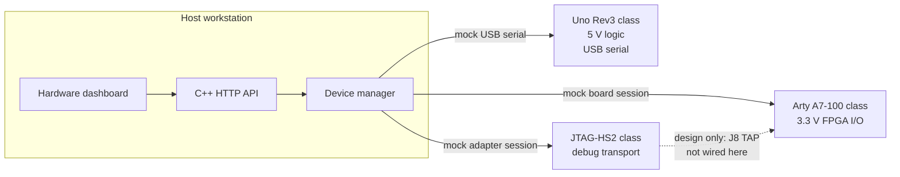

# Embedded-system integration

This document is the host-side integration design for three reference devices and the C++ hardware manager in the Unified Engineering Workbench. It is a design record for a simulation. No board was attached, programmed, or measured while writing it.

Manufacturer figures below are quoted from the cited documents. Numbers that exist only inside this simulation are collected under [Simulation assumptions](#simulation-assumptions). Those assumptions are not electrical specifications.

## A. System block diagram

The host workstation runs the workbench. The C++ device manager talks to three separate adapters. The adapters do not share a voltage domain, a connector, or a protocol. In this repository the links are function calls. The diagram shows the links a later physical build would have to design. Those links are not wired here.

```text
+--------------------------- host workstation ---------------------------+
|  Browser dashboard                                                      |
|       |  HTTP on localhost                                               |
|  C++ hardware manager                                                    |
|       |                    |                         |                   |
|  MCU adapter         FPGA adapter            JTAG adapter               |
+-------|--------------------|-------------------------|-------------------+
        | USB serial         | USB (board port)        | USB (cable)
        | documented 5 V     | documented 3.3 V I/O    | VREF from target
        v                    v                         v
+----------------+   +----------------------+   +----------------------+
| Arduino Uno    |   | Digilent Arty A7-100 |   | Digilent JTAG-HS2    |
| Rev3 class     |   | class FPGA board     |   | class debug adapter  |
| ATmega328P     |   | XC7A100T             |   | not a processor      |
| 5 V logic      |   | 3.3 V FPGA I/O       |   |                      |
+----------------+   +----------+-----------+   +----------+-----------+
                                ^                          |
                                | JTAG header J8           |
                                | TMS TDI TDO TCK          |
                                | GND and VCC3V3 reference |
                                +--------------------------+
                        This JTAG link is a design relationship.
                        It is not connected in this project.
```



The dashed JTAG link is the reference relationship between the cable and the FPGA header. The manager still treats the cable and the FPGA as different devices, because a debug adapter is not the programmable part.

## B. Device interface table

| Property | Microcontroller | FPGA development board | JTAG debug adapter | Host workstation |
| --- | --- | --- | --- | --- |
| Device type | Stored-program microcontroller | Programmable logic board | Debug and programming transport | Engineering workstation running this workbench |
| Example reference hardware | Arduino Uno Rev3, ATmega328P. Sources: [Arduino Uno Rev3](https://docs.arduino.cc/hardware/uno-rev3/) and the [A000066 datasheet](https://docs.arduino.cc/resources/datasheets/A000066-datasheet.pdf) | Digilent Arty A7-100, XC7A100TCSG324-1. Source: [Arty A7 Reference Manual](https://digilent.com/reference/programmable-logic/arty-a7/reference-manual) | Digilent JTAG-HS2. Source: [JTAG-HS2 Reference Manual](https://digilent.com/reference/programmers/jtag-hs2/reference-manual). The Arty manual names this cable for header J8 | The machine running `workbench_server` and the browser |
| Supply voltage | Operating voltage 5 V. USB, or VIN recommended 7 V to 12 V with a stated limit of 6 V to 20 V. Below 7 V the 5 V rail may sag. Above 12 V the regulator may overheat | The board needs a 5 V source. That source is USB port J10, or a 7 V to 15 V center-positive supply on jack J13 or header J7 pin 8. Onboard regulators then make 3.3 V, 1.8 V, 1.35 V, 1.25 V, 1.00 V, and 0.675 V | USB bus power for the cable itself. The cable does not power the FPGA | The PC's own supply. USB VBUS is a host power pin, not a license to feed an FPGA I/O bank |
| Ground / reference | Uno GND is the 5 V logic reference. A signal shared with another board needs a ground connection to that board | Arty GND is the reference for the 3.3 V I/O bank and for J8 | The cable's ground pins must share the target's ground so VREF means the same voltage on both ends | USB shield and signal ground are not a substitute for a deliberate logic ground between boards |
| I/O voltage domain | Digital pins operate at 5 V. IOREF is tied to 5 V. The 3.3 V header pin is a 50 mA supply output, not the logic level | FPGA I/O, Pmods, LEDs, buttons, switches, USB, and Ethernet are on the 3.3 V rail. Shield IOREF is 3.3 V. Digilent warns that shield or Pmod pins must not be driven above 3.4 V. The shield 5V0 pin is a power rail | JTAG buffers follow target VREF. Operating VREF is 1.65 V to 5.5 V. Absolute maximum VREF is -0.5 V to 6 V. For an Arty A7 target the JTAG bank reference is 3.3 V | No logic-level domain. The host sees USB packets, not 5 V or 3.3 V GPIO |
| Host communication | USB serial through the onboard USB-to-serial bridge. Published Uno text names an ATmega USB-serial converter; older and newer product text disagree between ATmega8U2 and ATmega16U2, so this design does not depend on that bridge's exact part number | Micro-USB J10 carries onboard USB-JTAG and USB-UART through an FTDI FT2232HQ. That path is independent of header J8 | Micro-USB from the cable to the host. The host enumerates a programming cable even when the target end is unplugged, according to the HS2 manual | HTTP on localhost between the browser and the C++ server. The server calls in-process mock adapters |
| Connector assumptions | USB-B to the host. 0.1 inch headers for GPIO, power, and the 2x3 ICSP programming header | Micro-USB J10, barrel jack J13, shield headers, four 12-pin Pmods, and 6-pin JTAG header J8 | 6-pin 100-mil Digilent programming header, or the Xilinx 2x7 2 mm header through the included adaptor. These are different connectors | USB host ports only, and only in a future physical build. This software does not open them |
| Level shifting | Required before any Uno digital pin may drive an Arty shield or Pmod pin. 5 V into a pin rated to 3.4 V is outside the Arty warning | Not required on JTAG if the HS2 VREF pin is tied to the Arty 3.3 V JTAG reference. Required if a 5 V device drives any 3.3 V I/O | The HS2 shifts its own buffers to VREF. It does not translate a 5 V MCU bus into a 3.3 V FPGA bank | None inside the host |
| Relevant signals | D0 RX and D1 TX for the USB-serial bridge. SPI on D11 MOSI, D12 MISO, D13 SCK. I2C on A4 SDA and A5 SCL. ICSP repeats the SPI programming set plus reset, 5 V, and ground | User I/O on the shield and Pmod connectors at 3.3 V. UART on the USB bridge is a separate pair from JTAG. JTAG on J8 is TMS, TDI, TDO, TCK, GND, and the 3.3 V reference | TMS, TCK, and TDI are driven by the cable. TDO is received by the cable. GND is common. VREF/VDD sets the buffer voltage and is sourced by the target | HTTP routes under `/api/hardware/`. No electrical signals |
| Pinout assumptions | Digital-header functions above are from Arduino's Uno Rev3 product text. This design does not publish a numbered ICSP pin chart. The ICSP signal set is MISO, MOSI, SCK, reset, 5 V, and ground | J8 pin association is taken from the net names in Digilent's [Arty A7 schematic](https://digilent.com/reference/_media/programmable-logic/arty-a7/arty-a7-e2-sch.pdf), drawing `arty-a7-e2-sch.pdf`: pin 1 TMS, pin 2 TDI, pin 3 TDO, pin 4 TCK, pin 5 GND, pin 6 VCC3V3. Confirm pin 1 on the drawing before any physical mating. Pmod pins 6 and 12 are 3.3 V, pins 5 and 11 are ground | The HS2 manual says the 6-pin end mates with Digilent's programming header. It does not print a second pin order that would contradict J8. The 14-pin adaptor is the Xilinx header, not the Arduino ICSP header | None |

Catalog resources for the XC7A100TCSG324-1, as printed in the Arty A7 purchasing table: 15,850 look-up tables, 126,800 flip-flops, 607.5 KB block RAM, and 6 clock-management tiles. Xilinx's 7 Series data sheet DS181 lists 15,850 slices for the XC7A100T and publishes block RAM as 4,860 Kb, which is the same 607.5 KB. Digilent's look-up-table label matches the slice count. This workbench reports Digilent's table and does not replace it with a different LUT total.

Uno memory and clock, from the Arduino product specification: 32 KB flash of which 0.5 KB is used by the bootloader, 2 KB SRAM, 1 KB EEPROM, 16 MHz. Recommended I/O current is 20 mA per pin. Arduino's board text says 40 mA must not be exceeded on an I/O pin.

## C. Electrical reasoning

### 1. Common ground

A logic level is a voltage difference from a local reference. The Uno's "5 V" is 5 V above Uno ground. The Arty's "3.3 V" is 3.3 V above Arty ground. If those grounds are not connected, the difference between a driver and a receiver is undefined. The receiver threshold no longer means what the datasheet says, and the voltage between a pin and the other board's ground can exceed an absolute maximum even when each board looks fine on its own meter. Every signal also needs a return path. That path is the ground connection. One signal wire without ground is not a circuit.

### 2. Why 5 V and 3.3 V cannot be tied together

The Uno drives a high digital output at its 5 V domain. The Arty reference manual says the shield and Pmod pins use a 3.3 V standard and must not be driven above 3.4 V. Connecting those pins directly puts a 5 V source onto a 3.3 V input. The input's protection structures can conduct, current is then limited mostly by the driver's impedance, and the FPGA pin can be damaged. The opposite direction is also unsafe to assume: a 3.3 V high may or may not meet a 5 V input's high threshold, depending on that input's VIH. The Uno's VIH is a property of the ATmega328P at 5 V, not something a connector makes true. The boards also expose 5 V as a power rail on both shield headers. Joining those rails is a power-supply decision, not a logic-level decision.

### 3. When bidirectional level shifting is required

A unidirectional translator is enough when one side always drives. On the JTAG link that is the normal case for TCK, TDI, and TDO: the adapter drives TCK and TDI, and the target drives TDO. TMS is driven by the adapter in ordinary IEEE 1149.1 use. The HS2 manual also allows the target to drive TMS in IEEE 1149.7 two-wire modes, so that one net can be driven from either end and the cable already includes series resistance for that conflict.

Bidirectional translation is required when either side may drive the same net and the voltage domains differ. Examples are I2C SDA and SCL, or a GPIO whose direction changes. A shifter used that way needs both supplies, or an equivalent pair of references, plus the shared ground. A resistor divider only reduces a high-to-low output. It does not let the low-voltage side drive the high-voltage side, and it is a poor fit for an open-drain bus.

The HS2 does not remove the need for a shifter between the Uno and the Arty. Its buffers follow one VREF. They do not sit between a 5 V bus and a 3.3 V bus at the same time.

### 4. Power source and back-powering

Each board already has a way to receive power. Adding a second path can push current backward into a port that was supposed to be a source.

- The Uno can be powered from USB or from VIN. Arduino's product text warns that VIN below 7 V lets the 5 V rail sag, and VIN above 12 V can overheat the regulator. Feeding the Uno 5 V pin from another board while USB is connected can back-power the host port. This design does not do that.
- The Arty selects its 5 V source from USB J10 or from the external jack. The manual says an external supply on J13 wins over USB, and that removing the external supply while USB remains can brown-out the board. J8 is not listed as a power input. The JTAG VREF pin must not be used to power the FPGA.
- The JTAG-HS2 is powered from its own USB port. Its VDD/VREF pin is an input that sets the buffer voltage. The manual requires it to be tied to the same supply that drives the target JTAG port. It is not a 5 V output for the Uno and not a 3.3 V output for the Artix-7 core.
- The Artix-7 core on the Arty is the regulated 0.95 V / 1.0 V rail from the onboard DA9062, not the 3.3 V I/O rail and not USB VBUS. Those rails must not be shorted because they happen to be called "power".

### 5. Connector compatibility is not electrical compatibility

The Arty shield headers are mechanically close to Arduino headers, and Digilent says many Arduino shields fit. The same manual then says the board is not compatible with shields that output 5 V digital or analog signals. The plastic matches. The voltage does not.

A 6-pin 0.1 inch plug can also mate with the Uno ICSP header and with Arty J8. The ICSP header carries SPI programming signals, reset, 5 V, and ground. J8 carries TMS, TDI, TDO, TCK, ground, and a 3.3 V reference. Forcing the JTAG-HS2 onto the ICSP header would put JTAG drivers onto SPI and reset pins, at whatever voltage VREF happened to be, and would present 5 V where the cable expects the JTAG reference arrangement. The HS2's 14-pin 2 mm adaptor is a third mechanical interface. Fitting an adaptor does not turn that header into a 5 V Arduino port.

IOREF exists so a shield can learn the board's logic voltage. On the Uno it is 5 V. On the Arty it is 3.3 V. Ignoring IOREF and wiring by pin position is how a fitting shield becomes an overvoltage fault.

### 6. JTAG is not an interchangeable compute board

IEEE 1149.1 JTAG is a test access port. A controller shifts instructions and data through a target TAP using TCK and TMS, with TDI into the target and TDO back from the target. That is how a host configures an FPGA or inspects boundary-scan cells. The JTAG-HS2 manual describes a programming cable for Xilinx tools. It does not describe a processor, a memory map, or a place to run the engineering application.

The ATmega328P-class Uno profile does not provide this TAP. Its host link is USB serial, and its programming header is ICSP. The Artix-7 is the programmable device. The cable is only the transport used to reach that device's TAP. Connecting the cable does not, by itself, give the workbench another computer.

## D. JTAG signals

Directions below are the ones the JTAG-HS2 manual and the IEEE names imply. "Adapter" means the HS2 acting as the debug and test controller. "Target" means the TAP on the Arty A7's Artix-7, reached through J8. The adapter columns are not the FPGA's pin directions.

| Signal | Who drives it | Direction | Role on this reference pair |
| --- | --- | --- | --- |
| TCK | Adapter | Adapter to target | Test clock. The target samples the bus from this clock. The HS2 manual lists TCK as an output. |
| TMS | Adapter in normal 1149.1 use. Either side may drive it in the HS2's 1149.7 two-wire modes | Adapter to target, except when the target is allowed to answer | Selects TAP states. The HS2 drives it through a 100 ohm series resistor and a weak pull-up. |
| TDI | Adapter | Adapter to target | Test data in, from the target's point of view. The HS2 manual lists TDI as an output. |
| TDO | Target | Target to adapter | Test data out of the target. The HS2 manual lists TDO as an input, with its own VIH and VIL. |
| GND | Both boards, tied together | Reference, not a data driver | Return and voltage reference. Without it, VREF and the logic levels are not defined between the two devices. |
| VTref / VREF / VDD | Target sources it. The adapter only senses it | Target to adapter | Sets the adapter's buffer levels. On Arty J8 pin 6 the schematic net is VCC3V3. The HS2 manual says this pin must be the same supply that drives the FPGA JTAG port. It does not power the board. |
| TRST | Optional adapter output, active low, when the connector has it | Adapter to target TAP reset | Optional asynchronous TAP reset in IEEE 1149.1. The HS2 6-pin header described for Arty J8 does not carry TRST. This design does not invent a TRST pin on J8. |
| SRST | Optional, often open-drain, when the connector has it | Adapter to target system reset | System reset of a processor, separate from TAP reset. Digilent's JTAG-HS3 puts an open-drain reset on pin 14 of the 14-pin header for Zynq PS_SRST_B. The HS2 6-pin header used with Arty J8 does not carry that pin. The Arty RESET button and CK_RST net are board resets, not an SRST wire from the HS2. |

TDI and TDO are named from the target. Swapping them is a common wiring fault: the adapter would drive into the target's output and listen to the target's input.

## E. Safe hypothetical integration plan

This plan is not a procedure that was carried out. Do not treat it as permission to wire the boards. A physical build would start with the current schematics, the absolute maximum ratings, and the boards unpowered.

1. Keep the three reference devices electrically separate until each supply and each ground is identified on its own drawing. The Uno stays in a 5 V logic domain. The Arty stays in a 3.3 V logic domain. The JTAG cable takes its levels from the target VREF rather than from the Uno.
2. Power the Arty only from J10 or from a 7 V to 15 V center-positive supply on J13, within the manual's current guidance. Do not power it from J8, from the Uno 5 V pin, or from the JTAG cable.
3. Power the Uno from its own USB port or from VIN inside the published 7 V to 12 V recommendation. Do not feed the Uno 5 V pin from the Arty while the Uno USB cable is attached.
4. If a JTAG cable is ever mated, use the HS2 6-pin end on Arty J8 only, after the schematic's pin 1 orientation is checked on the drawing. Connect VREF to the target reference already present on J8 pin 6. Connect ground. Do not mate that plug with the Uno ICSP header.
5. Leave Uno GPIO and Arty GPIO unconnected. A later design that needs those signals would add a level translator with a 5 V side and a 3.3 V side and a shared ground. Open-drain buses would use a bidirectional part. That translator is not selected or built here.
6. Share ground only for signals that actually run between boards. Do not join VIN, the Artix-7 core rail, and USB VBUS because each of them is "power".
7. The software in this repository stops before any of those steps. Connect and disconnect in the dashboard change adapter state inside the process. They do not open USB, serial, or JTAG.

## F. Limitations

- No real hardware access. The adapters are C++ objects.
- No physical wiring and no continuity or voltage measurement.
- No PCB fabrication and no custom level-shifter board.
- No firmware build, upload, or serial console on a microcontroller.
- No FPGA synthesis, bitstream generation, or configuration.
- No JTAG scan, IDCODE read, boundary scan, or debug session.
- Simulated telemetry repeats documented rail labels and fixed illustrative values. It is not an ADC reading and it is not a passing hardware test.
- The simulated JTAG timeout is a flag in the adapter. It does not measure a cable, a deadline on a wire, or a missing target.
- Device "availability" means the mock profile is registered. The operating system was not asked to enumerate USB devices.
- Connector pin associations for J8 are taken from schematic net names. They were not confirmed on a physical board.

## Simulation assumptions

These values are chosen for the mock. They are not manufacturer limits.

| Item | Value used in the mock | Why it is not a specification |
| --- | --- | --- |
| MCU temperature | 28.5 C | Illustrative constant. The Uno datasheet does not define this as a telemetry reading. |
| MCU supply reading | 5.0 V | Repeats the documented operating voltage so the label is recognizable. It is not a measurement. |
| FPGA I/O reading | 3.3 V | Repeats the documented I/O rail. The XADC was not configured and no sample was taken. |
| JTAG VREF reading | 3.3 V | Repeats the Arty J8 VCC3V3 net. No target was attached, so no voltage was observed. |
| Connection timeout | The next JTAG `connect` fails once, then the following `connect` can succeed | Deterministic software flag. There is no timer and no physical timeout. |
| Online status | The string "Online" after a simulated connect | Session flag inside the process. It does not mean a cable enumerated. |

## Sources

- Arduino, [UNO R3](https://docs.arduino.cc/hardware/uno-rev3/), product specification for the ATmega328P board: 5 V operation, VIN range, pin current, memory, and clock.
- Arduino, [A000066 datasheet](https://docs.arduino.cc/resources/datasheets/A000066-datasheet.pdf), board datasheet for the Uno.
- Digilent, [Arty A7 Reference Manual](https://digilent.com/reference/programmable-logic/arty-a7/reference-manual), power rails, 3.3 V I/O warning, J8 and J10, and the XC7A100T purchasing table.
- Digilent, [Arty A7 schematic](https://digilent.com/reference/_media/programmable-logic/arty-a7/arty-a7-e2-sch.pdf), J8 net names.
- Digilent, [JTAG-HS2 Reference Manual](https://digilent.com/reference/programmers/jtag-hs2/reference-manual), USB power, VREF range, and which signals the cable drives.
- Xilinx, 7 Series FPGAs Data Sheet DS181, XC7A100T slice count and 4,860 Kb block RAM. Used only to explain Digilent's purchasing table, not as a live device reading.
